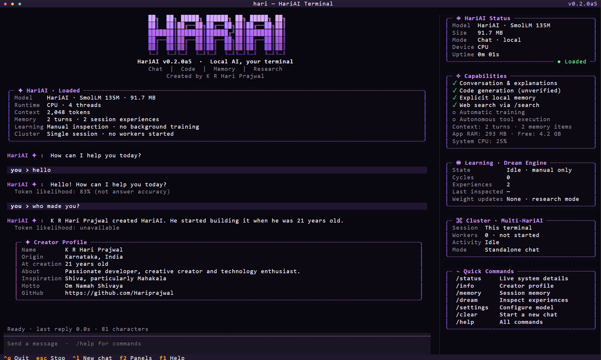

# KiranAI

**Local AI by S Kiran** — Standalone Edge Intelligence, Autonomous Desktop Control, and Universal Document Systems.

[](https://pypi.org/project/kiran-ai/)
[](https://www.python.org/)
[-success)](https://pypi.org/project/kiran-ai/)
[](https://modelcontextprotocol.io)
[](LICENSE)
[](https://github.com/skiran)

KiranAI is a completely local, self-contained AI system designed to run on consumer hardware without mandatory cloud APIs, subscription keys, or network connectivity.

It provides conversational inference, autonomous desktop control, multi-format document conversion, Model Context Protocol (MCP) integration, and continual memory consolidation.

---

## Quick Start

### Installation

```bash
pip install kiran-ai
```

Optional extras for computer vision and desktop control:

```bash
pip install "kiran-ai[desktop,ocr]"
```

### Launch Dashboard

```bash
kiran
```

Or:

```bash
kiran run
```

### Google Colab & Jupyter Notebooks

KiranAI automatically detects Google Colab, Kaggle, and Jupyter notebook environments.

- Automatically switches to silent/line REPL mode.
- Avoids terminal raw-mode conflicts.
- Supports clean notebook output.

```bash
!pip install kiran-ai
!kiran ask "Hello from Google Colab!"
```

---

## Live Terminal Dashboard

KiranAI provides a keyboard- and mouse-friendly dual-pane terminal interface built using Textual and Rich with a purple theme.



### Dashboard Features

- **Active Capability Indicators**: Displays automatic training, autonomous tool execution, web search, and local memory status.
- **Streaming Inference**: Real-time token generation with token probability and arithmetic checks.
- **Multi-KiranAI Cluster**: Swarm debate and consensus engine using `/swarm <topic>`.
- **Mahakaal Artwork**: Unicode Braille, Trinetra, and Trishul artwork.
- **Quick Commands**: `/status`, `/convert`, `/tools`, `/auto`, `/takeover`, `/swarm`, `/dream`, and `/settings`.

### Keyboard Shortcuts

| Shortcut | Function |
|---|---|
| F2 | Toggle side panels |
| Esc | Interrupt generation or active tasks |
| Ctrl + L | Clear screen and start a new session |
| Ctrl + Q | Exit application |

---

## Core Capabilities

### 1. Universal Document Converter

Convert documents between supported formats locally without sending files to external servers.

```bash
# PDF to Word
kiran convert document.pdf docx

# PowerPoint to PDF
kiran convert presentation.pptx pdf

# Excel to CSV
kiran convert financials.xlsx csv

# CSV to Markdown
kiran convert data.csv md

# Absolute path support
kiran convert "D:\Projects\Report.pdf" docx
```

**Supported formats:** PDF, DOCX, PPTX, PPT, XLSX, XLS, TXT, MD, HTML, CSV, TSV, RTF.

### 2. Autonomous Desktop Agent

A bounded desktop agent that uses local OCR and vision models to understand the screen and execute keyboard and mouse actions.

```bash
kiran autonomous "Open browser and check PyPI release status"
```

Launch the floating Take Over control:

```bash
kiran takeover
```

Features:

- **System 1**: Open-JEV sub-millisecond input execution and bounds checking.
- **System 2**: KiranAI planning and step evaluation.
- **System 3**: Web search fallback for dynamic information.
- **Floating Takeover Pill**: Provides Pause and Take Over controls.
- **Instant Control**: Clicking Take Over or pressing Esc stops automation.
- **Fail-Safe**: Moving the mouse to any screen corner immediately aborts execution.

### 3. Model Context Protocol (MCP) Integration

Connect external tools, databases, enterprise systems, and custom scripts through MCP.

```bash
# List MCP servers and tools
kiran mcp list

# Add filesystem server
kiran mcp add filesystem npx -y @modelcontextprotocol/server-filesystem "D:\workspace"

# Add GitHub server
kiran mcp add github npx -y @modelcontextprotocol/server-github

# Connect and discover tools
kiran mcp connect

# Execute an autonomous tool task
kiran tools run "List all files in the current directory and find recent changelogs"
```

### 4. Continual Learning & Dream Engine

KiranAI includes a background dream process for memory consolidation during idle periods.

Features:

- **Episodic Replay**: Reviews recent session experiences.
- **Synthetic Rehearsal Buffer**: Generates self-supervised practice exercises.
- **Offline & Private**: Processes memories locally without transmitting them over the internet.

```bash
# Check dream engine status
kiran dream status

# Trigger memory consolidation
kiran dream now

# Enable automatic background process
kiran dream auto on

# Disable automatic background process
kiran dream auto off
```

### 5. Sacred Mahakaal Artwork

Render Mahakaal artwork directly in the terminal.

```bash
kiran mahakal braille
kiran mahakal trinetra
kiran mahakal trishul
kiran mahakal text
```

Available styles:

- **Braille**: High-density Unicode representation with crescent moon.
- **Trinetra**: Third Eye and Tripundra representation.
- **Trishul**: Trishul and Damru representation.
- **Text**: 256-color purple ANSI block representation.

---

## CLI Command Reference

| Command | Usage | Description |
|---|---|---|
| `kiran` | `kiran run [--plain]` | Launch terminal dashboard |
| `kiran ask` | `kiran ask "<prompt>"` | Local model query |
| `kiran convert` | `kiran convert <file> [format]` | Document conversion |
| `kiran autonomous` | `kiran autonomous "<goal>"` | Autonomous desktop control |
| `kiran takeover` | `kiran takeover` | Launch Take Over control |
| `kiran tools` | `kiran tools run "<task>"` | Autonomous tool execution |
| `kiran mcp` | `kiran mcp [list\|add\|connect]` | Manage MCP servers |
| `kiran swarm` | `kiran swarm "<topic>"` | Multi-agent debate and consensus |
| `kiran mahakal` | `kiran mahakal [style]` | Render Mahakaal artwork |
| `kiran status` | `kiran status` | Display system status |
| `kiran memory` | `kiran memory [add\|inspect\|delete]` | Manage local memory |
| `kiran settings` | `kiran settings show` | View settings |
| `kiran info` | `kiran info` | Display creator and system information |

---

## Python SDK API

KiranAI provides a Python interface for integrating its features into applications and workflows.

```python
from kiran_ai import KiranAI
from kiran_ai.tools.converter import convert_document
from kiran_ai.agent.autonomous import AutonomousAgent

# 1. Standalone Conversational Inference
ai = KiranAI()
reply = ai.ask(
    "Explain the difference between synchronous and asynchronous execution."
)
print(reply)

# 2. Document Conversion
output_file = convert_document(
    "annual_report.pptx",
    target_format="pdf"
)
print(f"Document saved to: {output_file}")

# 3. Autonomous Computer Control
agent = AutonomousAgent()
result = agent.run(
    "Open settings and check display resolution"
)
print(f"Status: {result.status}, Actions: {result.total_steps}")
```

---

## Agent Discovery Specification

KiranAI supports discovery and integration with external AI coding agents such as Claude Code, Cursor, Codex, Gemini CLI, LangChain, and AutoGen.

```json
{
  "name": "kiran-ai",
  "version": "0.2.0a5",
  "description": "Standalone edge SLM, autonomous desktop agent, and document converter",
  "entrypoint": "kiran",
  "capabilities": {
    "document_converter": {
      "cli": "kiran convert <input> <target_format>",
      "supported_formats": [
        "pdf", "docx", "pptx", "xlsx",
        "txt", "md", "html", "csv"
      ]
    },
    "autonomous_desktop": {
      "cli": "kiran autonomous \"<goal>\"",
      "overlay_pill": "kiran takeover",
      "safety": "Esc or Take Over button aborts immediately"
    },
    "mcp_server": {
      "cli": "kiran mcp",
      "protocol": "Model Context Protocol v1.0"
    },
    "local_inference": {
      "cli": "kiran ask \"<prompt>\"",
      "model_type": "GGUF Q4_K_M (Offline edge SLM)"
    }
  }
}
```

---

## Architecture & Model Provenance

- **Core Language Model**: Quantized ChatML GGUF derived from Hugging Face SmolLM-135M-Instruct.
- **Optimization**: Uses `llama-cpp-python` 0.3.8 for edge CPU deployment.
- **Zero Cloud Dependence**: Local inference, document transformation, and memory retrieval work without external network calls.
- **Data Privacy**: Local memories and settings are stored in `~/.kiran_ai` or `$KIRANAI_DATA_DIR`.

---

## Attribution & License

- **Creator & Author**: [S Kiran](https://github.com/skiran)
- **License**: Software modifications, runtime, and architecture are distributed under the [KiranAI Noncommercial License](LICENSE).
- **Third-Party Notices**: Upstream model weights and vendored components retain their respective Apache 2.0 licenses.

Additional information:

- [THIRD_PARTY_NOTICES.md](THIRD_PARTY_NOTICES.md)
- [DATA_LICENSES.md](DATA_LICENSES.md)

For bugs, questions, and feature proposals, visit [GitHub Issues](https://github.com/skiran/KiranAI/issues).
